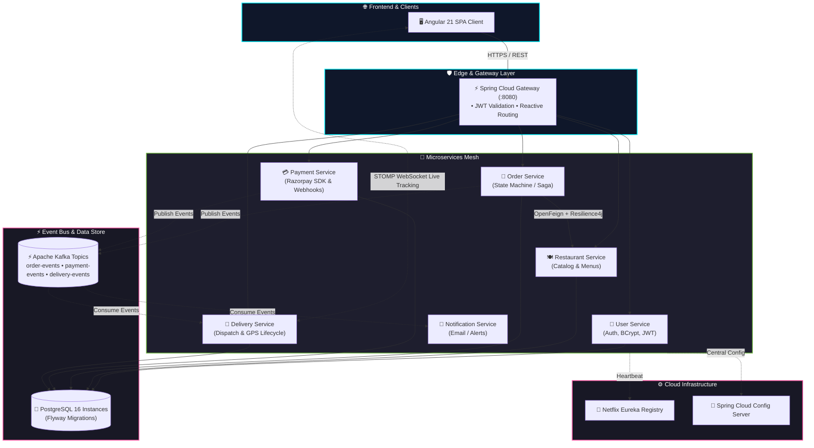

<!-- ═══════════════════════════ HEADER ═══════════════════════════ -->
<div align="center">

  <!-- Dynamic Animated Cyber Waving Banner (Twinkling Stars + Gradient Wave) -->
  

  <br/>

  <!-- Multi-line Dynamic Terminal Typing Animation -->
  <a href="https://github.com/UDAY1810">
    
  </a>

  <!-- Animated Real-time Status Badges & Quick Links -->
  <p align="center">
    <a href="mailto:mrdubey7717@gmail.com">
      
    </a>
    <a href="https://linkedin.com/in/" target="_blank">
      
    </a>
    <a href="https://instagram.com/" target="_blank">
      
    </a>
    
  </p>

</div>

<!-- Animated Laser Gradient Divider -->


<!-- ═══════════════════════════ SYSTEM TELEMETRY ═══════════════════════════ -->
### 🖥️ `systemctl status backend-core.service`

```bash
● backend-core.service - High-Throughput Distributed Microservices Engine
     Loaded: loaded (/etc/systemd/system/backend-core.service; enabled; vendor preset: enabled)
     Active: active (running) • High Availability (SLA 99.99%)
   Main PID: 2026 (java -XX:+UseG1GC -jar microservices-runtime.jar)
   Runtimes: Java 21 (Loom Virtual Threads) • Spring Boot 3.x • Spring Cloud
   Pipeline: Apache Kafka Event Streams • PostgreSQL 16 • Docker Compose
   Security: Stateless JWT Bearer • Spring Security • Role-Based Access Control
   CGroup: /system.slice/backend-core.service
           ├─ 01 [api-gateway]          → Reactive Edge Routing (:8080) & JWT Filters
           ├─ 02 [discovery-server]     → Netflix Eureka Service Registry & Health Pings
           ├─ 03 [config-server]        → Centralized Git-backed Cloud Configuration
           ├─ 04 [order-service]        → State Machine & Distributed Saga Flow
           ├─ 05 [payment-service]      → Razorpay Client SDK & Webhook Verification
           ├─ 06 [restaurant-service]   → Menu Catalogs & Resilience4j Circuit Breakers
           ├─ 07 [delivery-service]     → Real-Time STOMP WebSocket Live Dispatch
           └─ 08 [notification-service] → Async Kafka Consumer & Email Dispatcher
```

<!-- Animated Laser Gradient Divider -->


<!-- ═══════════════════════════ ARCHITECTURE PHILOSOPHY ═══════════════════════════ -->
### ⚡ Architecture & Engineering Principles

<table>
  <tr>
    <td width="50%" valign="top">
      <h4>🛡️ Distributed Resilience & Scalability</h4>
      <ul>
        <li><b>Decoupled Microservices:</b> Domain-Driven Design (DDD) with clean bounded contexts.</li>
        <li><b>Fault Tolerance:</b> Circuit breakers, rate-limiting, and fallback paths via <b>Resilience4j</b>.</li>
        <li><b>Event-Driven Asynchrony:</b> Decoupling high-volume workflows with <b>Apache Kafka</b> event topics.</li>
        <li><b>Centralized Observability:</b> Distributed tracing with <b>Micrometer + Zipkin</b> and Actuator health probes.</li>
      </ul>
    </td>
    <td width="50%" valign="top">
      <h4>🚀 Data Integrity & API Performance</h4>
      <ul>
        <li><b>ACID & Migrations:</b> Deterministic database versioning with <b>Flyway</b> on PostgreSQL.</li>
        <li><b>Reactive Edge Gateway:</b> Non-blocking Spring Cloud Gateway with low-latency WebFlux routing.</li>
        <li><b>Real-Time Push:</b> Sub-second delivery tracking powered by <b>WebSocket (STOMP)</b>.</li>
        <li><b>Robust Test Pyramid:</b> Automated unit, integration, and controller testing with <b>JUnit 5 & Mockito</b>.</li>
      </ul>
    </td>
  </tr>
</table>

<!-- Animated Laser Gradient Divider -->


<!-- ═══════════════════════════ TECH ARSENAL ═══════════════════════════ -->
### 🛠️ The Tech Arsenal

<div align="center">

#### 🚀 Core Languages & Runtimes
<a href="https://skillicons.dev">
  
</a>

<br/><br/>

#### 🏛️ Frameworks & Server-Side Ecosystem
<a href="https://skillicons.dev">
  
</a>
<br/>
<p align="center">
  
  
  
  
</p>

#### 🗄️ Persistence, Streaming & Messaging
<a href="https://skillicons.dev">
  
</a>
<br/>
<p align="center">
  
  
  
  
</p>

#### 🚢 DevOps, Containerization & Automated Testing
<a href="https://skillicons.dev">
  
</a>
<br/>
<p align="center">
  
  
  
  
</p>

</div>

<!-- Animated Laser Gradient Divider -->


<!-- ═══════════════════════════ FEATURED PROJECT ═══════════════════════════ -->
### 🍔 Flagship Architecture: [QuickBite Microservices Platform](https://github.com/UDAY1810/quickbite)

<div align="center">

> **An enterprise-grade, event-driven food ordering & delivery ecosystem powered by Spring Boot 3, Spring Cloud, Apache Kafka, and Docker.**

[](https://github.com/UDAY1810/quickbite)


</div>



<!-- Animated Laser Gradient Divider -->


<!-- ═══════════════════════════ TELEMETRY & STATS ═══════════════════════════ -->
### 📊 Live GitHub Telemetry

<div align="center">

  <!-- Glowing Streak Counter -->
  <a href="https://github.com/UDAY1810">
    
  </a>

  <br/><br/>

  <!-- Stats Cards & Most Used Languages -->
  <a href="https://github.com/UDAY1810">
    
  </a>
  <a href="https://github.com/UDAY1810">
    
  </a>

</div>

<!-- ═══════════════════════════ QUOTE & FOOTER ═══════════════════════════ -->
<br/>

<div align="center">

  <!-- Animated Real-time Developer Quote -->
  

  <br/><br/>

  <!-- Glowing Footer Wave -->
  

  <sub>⚡ <b>Zero Downtime • Infinite Scalability • Clean Architecture</b> ⚡</sub>

</div>
