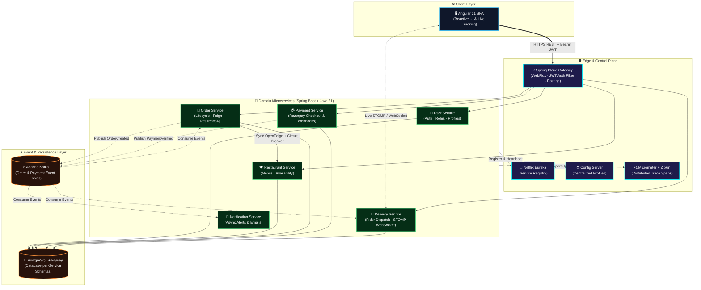

<!-- ══════════════════════════════════════════════════════════════════════════════ -->
<!--                         UDAY — BACKEND ENGINEER PROFILE                      -->
<!-- ══════════════════════════════════════════════════════════════════════════════ -->

<div align="center">

  <!-- Animated Venom Hero Banner -->
  

  <!-- Animated Typing SVG Headline -->
  <a href="https://github.com/UDAY1810">
    
  </a>

  <!-- Status & Contact Badges -->
  <p align="center">
    <a href="mailto:mrdubey7717@gmail.com">
      
    </a>
    <a href="https://github.com/UDAY1810">
      
    </a>
    <a href="https://www.linkedin.com/in/YOUR-LINKEDIN-ID/">
      
    </a>
    <a href="https://www.instagram.com/YOUR-INSTAGRAM-ID/">
      
    </a>
    
  </p>

  <!-- Quick System Telemetry Pills -->
  <p align="center">
    
    
    
    
  </p>

</div>


<!-- ═══════════════════════════ SYSTEM MANIFEST & ABOUT ═══════════════════════════ -->
##  `whoami` — Engineering Profile & Architecture Philosophy

<table>
  <tr>
    <td width="55%" valign="top">

```yaml
apiVersion: engineering.uday.dev/v1
kind: BackendEngineer
metadata:
  handle: UDAY1810
  role: "Backend & Distributed Systems Engineer"
  motto: "Make it work, make it right, make it fast."
spec:
  coreStack:
    languages: ["Java 21", "TypeScript", "SQL"]
    frameworks: ["Spring Boot 3", "Spring Cloud", "Spring Security", "JPA / Hibernate"]
    messaging: ["Apache Kafka", "WebSocket (STOMP)"]
    databases: ["PostgreSQL", "Flyway Migrations", "H2"]
  reliabilityAndScale:
    gateway: "Spring Cloud Gateway (Reactive WebFlux + JWT)"
    discovery: "Netflix Eureka + Spring Cloud Config Server"
    resilience: "OpenFeign + Resilience4j Circuit Breakers"
    observability: ["Micrometer Tracing", "Zipkin", "Spring Actuator"]
  currentMission:
    flagship: "QuickBite — 9-Microservice Food Delivery Platform"
    exploring: ["Kubernetes", "High-Scale System Design", "Distributed Sagas"]
```

</td>
<td width="45%" valign="top">

### ⚡ What I Bring to the Table

- 🏗️ **Microservices from the Ground Up:** Designing loosely coupled services with Spring Boot, Eureka, centralized Config Server, and reactive API Gateways.
- 🔄 **Event-Driven Choreography:** Decoupling critical workflows (orders, payments, notifications, live dispatch) over Apache Kafka and STOMP WebSockets.
- 🛡️ **Production-Grade Fault Tolerance:** Protecting inter-service boundaries with Resilience4j circuit breakers, JWT edge security, and end-to-end Zipkin distributed tracing.
- 🗄️ **Clean Data & Verified Code:** Versioned schema evolution with PostgreSQL + Flyway, backed by unit and integration test suites (JUnit 5, Mockito).

</td>
</tr>
</table>


<!-- ═══════════════════════════ TECH ARSENAL ═══════════════════════════ -->
## 🛠️ Tech Arsenal & Engineering Stack

<div align="center">
  
</div>

<br/>

| Domain | Core Technologies & Capabilities |
| :--- | :--- |
| **☕ Languages & Core** | **Java 21 LTS**, TypeScript, SQL, Bash scripting |
| **🌱 Spring Ecosystem** | **Spring Boot 3.x**, Spring Cloud, Spring Security (JWT), Spring Data JPA, Spring WebFlux |
| **🧭 Distributed & Cloud** | **Netflix Eureka**, Spring Cloud Gateway, Config Server, OpenFeign, Resilience4j, Micrometer + Zipkin |
| **⚡ Messaging & Realtime** | **Apache Kafka** (Event Topics & Choreography), **WebSocket (STOMP)** for real-time dispatch |
| **🗄️ Data, DevOps & QA** | **PostgreSQL 16**, Flyway DB Migrations, **Docker Compose**, Maven, JUnit 5, Mockito, Postman |


<!-- ═══════════════════════════ FLAGSHIP CASE STUDY ═══════════════════════════ -->
## 🍔 Flagship Architecture Spotlight — [QuickBite](https://github.com/UDAY1810/quickbite)

<div align="center">

### Cloud-Native Food Ordering & Real-Time Delivery Platform
*Engineered as a 9-microservice Spring Boot ecosystem paired with an Angular 21 SPA, Apache Kafka event backbone, and full observability.*

[](https://github.com/UDAY1810/quickbite)


</div>

<br/>

### 🗺️ End-to-End Distributed System Topology



<br/>

### 🔬 Architectural Pillars Inside QuickBite

| Pillar | Implementation Details |
| :--- | :--- |
| **🛡️ Edge Security & Reactive Routing** | **Spring Cloud Gateway (WebFlux)** acts as the single entry point, validating JWT signatures and propagating identity claims downstream before routing traffic. |
| **🧭 Dynamic Discovery & Externalized Config** | Zero hardcoded hosts — all microservices self-register with **Netflix Eureka** and pull environment configuration on startup from **Spring Cloud Config Server**. |
| **⚡ Event-Driven Choreography** | Order and Payment state transitions publish domain events to **Apache Kafka**, triggering asynchronous Delivery assignment and Notification dispatch without tight coupling. |
| **🔁 Fault-Tolerant Sync Calls** | Synchronous catalog checks between Order Service and Restaurant Service use declarative **OpenFeign** clients wrapped in **Resilience4j** circuit breakers and fallbacks. |
| **📡 Real-Time Order Telemetry** | Delivery Service pushes live rider and order status updates directly to the Angular 21 client over **WebSocket (STOMP)** channels. |
| **💳 Production Payment Flow & Auditing** | Dedicated Payment Service integrates **Razorpay**, verifying payment signatures and persisting versioned schemas via **PostgreSQL + Flyway** migrations. |
| **🔍 Full-Stack Observability & Testing** | End-to-end request correlation across service hops using **Micrometer Tracing + Zipkin**, paired with Spring Boot Actuator health probes and **JUnit 5 / Mockito** test coverage. |

<details>
<summary><b>⚡ Click to inspect how a single Order flows through QuickBite's 9 services</b></summary>
<br/>

1. **Authenticate & Request:** The customer places an order from the Angular 21 SPA; API Gateway verifies the Bearer JWT token and forwards the request to Order Service.
2. **Validate Menu Synchronous Check:** Order Service calls Restaurant Service via OpenFeign (guarded by a Resilience4j circuit breaker) to verify item availability and pricing.
3. **Payment Handshake:** Payment Service creates a Razorpay order and verifies the payment signature upon completion, publishing a payment confirmation event to Apache Kafka.
4. **Asynchronous Fan-Out:** Apache Kafka streams order & payment events to Delivery Service (to allocate a delivery partner) and Notification Service (to send instant confirmation).
5. **Live Customer Push:** As the order status progresses (`CONFIRMED` → `PREPARING` → `OUT_FOR_DELIVERY` → `DELIVERED`), Delivery Service broadcasts real-time updates over WebSocket (STOMP) while Zipkin records the entire distributed trace.

</details>


<!-- ═══════════════════════════ TELEMETRY & GITHUB STATS ═══════════════════════════ -->
## 📊 GitHub Telemetry & Contribution Pulse

<div align="center">

  <!-- Streak Stats -->
  

  <br/><br/>

  <!-- GitHub Stats & Top Languages Side-by-Side -->
  
  

</div>

<!-- ═══════════════════════════ CONTRIBUTION SNAKE ═══════════════════════════ -->
<!-- Requires the snake GitHub Action in UDAY1810/UDAY1810 (.github/workflows/snake.yml) -->
<div align="center">
  <picture>
    <source media="(prefers-color-scheme: dark)" srcset="https://raw.githubusercontent.com/UDAY1810/UDAY1810/output/github-snake-dark.svg" />
    <source media="(prefers-color-scheme: light)" srcset="https://raw.githubusercontent.com/UDAY1810/UDAY1810/output/github-snake.svg" />
    
  </picture>
</div>


<!-- ═══════════════════════════ CONNECT & FOOTER ═══════════════════════════ -->
<div align="center">

  ### 🤝 Let's Build High-Scale Systems Together
  *Always excited to collaborate on Java / Spring Boot Microservices, Event-Driven Architectures, and Backend Engineering opportunities.*

  <br/>

  <a href="mailto:mrdubey7717@gmail.com">
    
  </a>
  <a href="https://github.com/UDAY1810/quickbite">
    
  </a>

  <br/><br/>

  

  <br/><br/>

  

</div>
