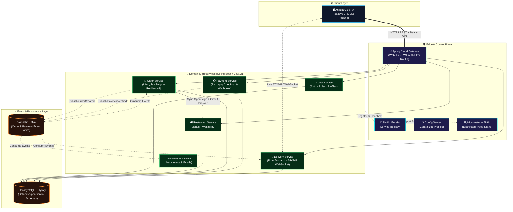

&lt;!-- ══════════════════════════════════════════════════════════════════════════════ --&gt;
&lt;!--                     UDAY — BACKEND ENGINEER PROFILE README                     --&gt;
&lt;!-- ══════════════════════════════════════════════════════════════════════════════ --&gt;

&lt;div align=&quot;center&quot;&gt;

&lt;!-- Animated Venom Hero Banner --&gt;
&lt;img src=&quot;https://capsule-render.vercel.app/api?type=venom&amp;color=0:070913,35:0f172a,70:1e3a8a,100:00f2fe&amp;height=300&amp;section=header&amp;text=UDAY%20%E2%80%A2%20BACKEND%20ENGINEER&amp;fontSize=50&amp;fontColor=ffffff&amp;fontAlignY=38&amp;stroke=00f2fe&amp;strokeWidth=1.2&amp;animation=twinkling&amp;desc=%E2%9A%A1%20Distributed%20Systems%20%C2%B7%20Event-Driven%20Microservices%20%C2%B7%20Cloud-Native%20Java&amp;descSize=19&amp;descAlignY=60&quot; width=&quot;100%&quot; alt=&quot;Uday — Backend Engineer Banner&quot; /&gt;

&lt;!-- Animated Typing SVG Headline --&gt;
&lt;a href=&quot;https://github.com/UDAY1810&quot;&gt;
  &lt;img src=&quot;https://readme-typing-svg.demolab.com?font=JetBrains+Mono&amp;weight=700&amp;size=22&amp;duration=2800&amp;pause=900&amp;color=00F2FE&amp;center=true&amp;vCenter=true&amp;width=820&amp;lines=%E2%98%95+Architecting+resilient%2C+high-throughput+Java+21+%26+Spring+Boot+backends;%E2%9A%A1+Event-driven+choreography+%26+real-time+streaming+with+Apache+Kafka;%F0%9F%A7%AD+Spring+Cloud+Eureka+%C2%B7+Reactive+API+Gateway+%C2%B7+Config+Server+%C2%B7+OpenFeign;%F0%9F%9B%A1%EF%B8%8F+Zero-trust+JWT+security+%C2%B7+Resilience4j+Circuit+Breakers+%C2%B7+Zipkin+Tracing;%F0%9F%8D%94+Currently+engineering+%E2%86%92+QuickBite+(9-Microservice+Food+Delivery+Platform)&quot; alt=&quot;Typing SVG&quot; /&gt;
&lt;/a&gt;

<br/>

&lt;!-- Status &amp; Contact Badges --&gt;
&lt;p align=&quot;center&quot;&gt;
  &lt;a href=&quot;mailto:mrdubey7717@gmail.com&quot;&gt;
    &lt;img src=&quot;https://img.shields.io/badge/Gmail-mrdubey7717%40gmail.com-EA4335?style=for-the-badge&amp;logo=gmail&amp;logoColor=white&amp;labelColor=161b22&quot; alt=&quot;Email&quot; /&gt;
  &lt;/a&gt;
  &lt;a href=&quot;https://github.com/UDAY1810&quot;&gt;
    &lt;img src=&quot;https://img.shields.io/badge/GitHub-UDAY1810-00F2FE?style=for-the-badge&amp;logo=github&amp;logoColor=white&amp;labelColor=161b22&quot; alt=&quot;GitHub&quot; /&gt;
  &lt;/a&gt;
  &lt;!-- Update YOUR-LINKEDIN-ID and YOUR-INSTAGRAM-ID below with your handles --&gt;
  &lt;a href=&quot;https://www.linkedin.com/in/YOUR-LINKEDIN-ID/&quot;&gt;
    &lt;img src=&quot;https://img.shields.io/badge/LinkedIn-Connect-0A66C2?style=for-the-badge&amp;logo=linkedin&amp;logoColor=white&amp;labelColor=161b22&quot; alt=&quot;LinkedIn&quot; /&gt;
  &lt;/a&gt;
  &lt;a href=&quot;https://www.instagram.com/YOUR-INSTAGRAM-ID/&quot;&gt;
    &lt;img src=&quot;https://img.shields.io/badge/Instagram-Follow-E4405F?style=for-the-badge&amp;logo=instagram&amp;logoColor=white&amp;labelColor=161b22&quot; alt=&quot;Instagram&quot; /&gt;
  &lt;/a&gt;
  &lt;img src=&quot;https://komarev.com/ghpvc/?username=UDAY1810&amp;style=for-the-badge&amp;color=00f2fe&amp;labelColor=161b22&amp;label=PROFILE+VIEWS&quot; alt=&quot;Profile views&quot; /&gt;
&lt;/p&gt;

&lt;!-- Quick System Telemetry Pills --&gt;
&lt;p align=&quot;center&quot;&gt;
  &lt;img src=&quot;https://img.shields.io/badge/STATUS-BUILDING_DISTRIBUTED_SYSTEMS-10B981?style=flat-square&amp;logo=statuspage&amp;logoColor=white&amp;labelColor=0d1117&quot; alt=&quot;Status&quot; /&gt;
  &lt;img src=&quot;https://img.shields.io/badge/PRIMARY_RUNTIME-JAVA_21_LTS-ED8B00?style=flat-square&amp;logo=openjdk&amp;logoColor=white&amp;labelColor=0d1117&quot; alt=&quot;Java 21&quot; /&gt;
  &lt;img src=&quot;https://img.shields.io/badge/ARCHITECTURE-MICROSERVICES_%26_KAFKA-38BDF8?style=flat-square&amp;logo=apachekafka&amp;logoColor=white&amp;labelColor=0d1117&quot; alt=&quot;Architecture&quot; /&gt;
  &lt;img src=&quot;https://img.shields.io/badge/OPEN_TO-BACKEND_%2F_SDE_ROLES-A855F7?style=flat-square&amp;logo=rocket&amp;logoColor=white&amp;labelColor=0d1117&quot; alt=&quot;Open To Roles&quot; /&gt;
&lt;/p&gt;

&lt;/div&gt;

&lt;img src=&quot;https://user-images.githubusercontent.com/74038190/212284100-561aa473-3905-4a80-b561-0d28506553ee.gif&quot; width=&quot;100%&quot; alt=&quot;divider&quot; /&gt;

&lt;!-- ═══════════════════════════ SYSTEM MANIFEST &amp; ABOUT ═══════════════════════════ --&gt;

## &lt;img src=&quot;https://media.giphy.com/media/hvRJCLFzcasrR4ia7z/giphy.gif&quot; width=&quot;28&quot; alt=&quot;wave&quot; /&gt; `whoami` — Engineering Profile & Architecture Philosophy

&lt;table&gt;
&lt;tr&gt;
&lt;td width=&quot;58%&quot; valign=&quot;top&quot;&gt;

```yaml
apiVersion: engineering.uday.dev/v1
kind: BackendEngineer
metadata:
  handle: UDAY1810
  role: "Backend & Distributed Systems Engineer"
  motto: "Make it work, make it right, make it fast."
spec:
  coreStack:
    languages: ["Java 21", "TypeScript", "SQL"]
    frameworks: ["Spring Boot 3", "Spring Cloud", "Spring Security", "JPA / Hibernate"]
    messaging: ["Apache Kafka", "WebSocket (STOMP)"]
    databases: ["PostgreSQL", "Flyway Migrations", "H2"]
  reliabilityAndScale:
    gateway: "Spring Cloud Gateway (Reactive WebFlux + JWT)"
    discovery: "Netflix Eureka + Spring Cloud Config Server"
    resilience: "OpenFeign + Resilience4j Circuit Breakers"
    observability: ["Micrometer Tracing", "Zipkin", "Spring Actuator"]
  currentMission:
    flagship: "QuickBite — 9-Microservice Food Delivery Platform"
    exploring: ["Kubernetes", "High-Scale System Design", "Distributed Sagas"]
```

&lt;/td&gt;
&lt;td width=&quot;42%&quot; valign=&quot;top&quot;&gt;

### ⚡ What I Bring to the Table

- **🏗️ Microservices from the Ground Up**
  Designing loosely coupled services with **Spring Boot**, **Eureka**, centralized **Config Server**, and reactive **API Gateways**.
- **🔄 Event-Driven Choreography**
  Decoupling critical workflows (orders, payments, notifications, live dispatch) over **Apache Kafka** and **STOMP WebSockets**.
- **🛡️ Production-Grade Fault Tolerance**
  Protecting inter-service boundaries with **Resilience4j** circuit breakers, **JWT** edge security, and end-to-end **Zipkin** distributed tracing.
- **🗄️ Clean Data & Verified Code**
  Versioned schema evolution with **PostgreSQL + Flyway**, backed by unit and integration test suites (**JUnit 5**, **Mockito**).

&lt;/td&gt;
&lt;/tr&gt;
&lt;/table&gt;

&lt;img src=&quot;https://user-images.githubusercontent.com/74038190/212284100-561aa473-3905-4a80-b561-0d28506553ee.gif&quot; width=&quot;100%&quot; alt=&quot;divider&quot; /&gt;

&lt;!-- ═══════════════════════════ TECH ARSENAL ═══════════════════════════ --&gt;

## 🛠️ Tech Arsenal & Engineering Stack

&lt;div align=&quot;center&quot;&gt;

&lt;img src=&quot;https://skillicons.dev/icons?i=java,spring,hibernate,kafka,postgres,docker,maven,ts,angular,git,github,postman,idea,vscode&amp;theme=dark&amp;perline=7&quot; alt=&quot;Tech Stack Icons&quot; /&gt;

&lt;/div&gt;

<br/>

| Domain | Core Technologies & Capabilities |
| :--- | :--- |
| **☕ Languages & Core** |       |
| **🌱 Spring Ecosystem** |      |
| **🧭 Distributed & Cloud** |     |
| **⚡ Messaging & Realtime** |    |
| **🗄️ Data, DevOps & QA** |       |

&lt;img src=&quot;https://user-images.githubusercontent.com/74038190/212284100-561aa473-3905-4a80-b561-0d28506553ee.gif&quot; width=&quot;100%&quot; alt=&quot;divider&quot; /&gt;

&lt;!-- ═══════════════════════════ FLAGSHIP CASE STUDY ═══════════════════════════ --&gt;

## 🍔 Flagship Architecture Spotlight — [QuickBite](https://github.com/UDAY1810/quickbite)

&lt;div align=&quot;center&quot;&gt;

### **Cloud-Native Food Ordering & Real-Time Delivery Platform**
*Engineered as a 9-microservice Spring Boot ecosystem paired with an Angular 21 SPA, Apache Kafka event backbone, and full observability.*

[](https://github.com/UDAY1810/quickbite)


&lt;/div&gt;

### 🗺️ End-to-End Distributed System Topology



### 🔬 Architectural Pillars Inside QuickBite

| Pillar | Implementation Details |
| :--- | :--- |
| **🛡️ Edge Security & Reactive Routing** | **Spring Cloud Gateway (WebFlux)** acts as the single entry point, validating **JWT** signatures and propagating identity claims downstream before routing traffic. |
| **🧭 Dynamic Discovery & Externalized Config** | Zero hardcoded hosts — all microservices self-register with **Netflix Eureka** and pull environment configuration on startup from **Spring Cloud Config Server**. |
| **⚡ Event-Driven Choreography** | **Order** and **Payment** state transitions publish domain events to **Apache Kafka**, triggering asynchronous **Delivery** assignment and **Notification** dispatch without tight coupling. |
| **🔁 Fault-Tolerant Sync Calls** | Synchronous catalog checks between **Order Service** and **Restaurant Service** use declarative **OpenFeign** clients wrapped in **Resilience4j** circuit breakers and fallbacks. |
| **📡 Real-Time Order Telemetry** | **Delivery Service** pushes live rider and order status updates directly to the **Angular 21** client over **WebSocket (STOMP)** channels. |
| **💳 Production Payment Flow & Auditing** | Dedicated **Payment Service** integrates **Razorpay**, verifying payment signatures and persisting versioned schemas via **PostgreSQL + Flyway** migrations. |
| **🔍 Full-Stack Observability & Testing** | End-to-end request correlation across service hops using **Micrometer Tracing + Zipkin**, paired with **Spring Boot Actuator** health probes and **JUnit 5 / Mockito** test coverage. |

&lt;details&gt;
&lt;summary&gt;&lt;b&gt;⚡ Click to inspect how a single Order flows through QuickBite&#39;s 9 services&lt;/b&gt;&lt;/summary&gt;
&lt;br/&gt;

1. **Authenticate & Request:** The customer places an order from the **Angular 21 SPA**; **API Gateway** verifies the `Bearer` JWT token and forwards the request to **Order Service**.
2. **Validate Menu Synchronous Check:** **Order Service** calls **Restaurant Service** via **OpenFeign** (guarded by a **Resilience4j** circuit breaker) to verify item availability and pricing.
3. **Payment Handshake:** **Payment Service** creates a **Razorpay** order and verifies the payment signature upon completion, publishing a payment confirmation event to **Apache Kafka**.
4. **Asynchronous Fan-Out:** **Apache Kafka** streams order & payment events to **Delivery Service** (to allocate a delivery partner) and **Notification Service** (to send instant confirmation).
5. **Live Customer Push:** As the order status progresses (`CONFIRMED` → `PREPARING` → `OUT_FOR_DELIVERY` → `DELIVERED`), **Delivery Service** broadcasts real-time updates over **WebSocket (STOMP)** while **Zipkin** records the entire distributed trace.

&lt;/details&gt;

&lt;img src=&quot;https://user-images.githubusercontent.com/74038190/212284100-561aa473-3905-4a80-b561-0d28506553ee.gif&quot; width=&quot;100%&quot; alt=&quot;divider&quot; /&gt;

&lt;!-- ═══════════════════════════ TELEMETRY &amp; GITHUB STATS ═══════════════════════════ --&gt;

## 📊 GitHub Telemetry & Contribution Pulse

&lt;div align=&quot;center&quot;&gt;

&lt;!-- Streak Stats --&gt;
&lt;img src=&quot;https://streak-stats.demolab.com/?user=UDAY1810&amp;theme=tokyonight&amp;hide_border=true&amp;background=0D1117&amp;ring=00F2FE&amp;fire=38BDF8&amp;currStreakLabel=00F2FE&amp;sideLabels=38BDF8&amp;dates=8B949E&amp;border_radius=10&quot; width=&quot;68%&quot; alt=&quot;GitHub Streak&quot; /&gt;

<br/><br/>

&lt;!-- GitHub Stats &amp; Top Languages Side-by-Side --&gt;
&lt;img src=&quot;https://github-readme-stats.vercel.app/api?username=UDAY1810&amp;show_icons=true&amp;include_all_commits=true&amp;hide=stars,prs,issues&amp;theme=tokyonight&amp;hide_border=true&amp;bg_color=0D1117&amp;title_color=00F2FE&amp;icon_color=38BDF8&amp;text_color=C9D1D9&amp;ring_color=00F2FE&amp;border_radius=10&quot; height=&quot;175&quot; alt=&quot;GitHub Stats&quot; /&gt;
&lt;img src=&quot;https://github-readme-stats.vercel.app/api/top-langs/?username=UDAY1810&amp;layout=compact&amp;langs_count=6&amp;theme=tokyonight&amp;hide_border=true&amp;bg_color=0D1117&amp;title_color=00F2FE&amp;text_color=C9D1D9&amp;border_radius=10&quot; height=&quot;175&quot; alt=&quot;Top Languages&quot; /&gt;

<br/><br/>

&lt;!-- Activity Graph --&gt;
&lt;img src=&quot;https://github-readme-activity-graph.vercel.app/graph?username=UDAY1810&amp;bg_color=0d1117&amp;color=38bdf8&amp;line=00f2fe&amp;point=ffffff&amp;area=true&amp;hide_border=true&amp;custom_title=Contribution%20Activity%20Graph&quot; width=&quot;95%&quot; alt=&quot;Activity Graph&quot; /&gt;

&lt;/div&gt;

&lt;!-- ═══════════════════════════ CONTRIBUTION SNAKE ═══════════════════════════ --&gt;
&lt;!-- Requires the snake GitHub Action in UDAY1810/UDAY1810 (.github/workflows/snake.yml) --&gt;
&lt;div align=&quot;center&quot;&gt;
  &lt;picture&gt;
    &lt;source media=&quot;(prefers-color-scheme: dark)&quot; srcset=&quot;https://raw.githubusercontent.com/UDAY1810/UDAY1810/output/github-snake-dark.svg&quot; /&gt;
    &lt;source media=&quot;(prefers-color-scheme: light)&quot; srcset=&quot;https://raw.githubusercontent.com/UDAY1810/UDAY1810/output/github-snake.svg&quot; /&gt;
    &lt;img alt=&quot;Contribution snake&quot; src=&quot;https://raw.githubusercontent.com/UDAY1810/UDAY1810/output/github-snake-dark.svg&quot; width=&quot;100%&quot; /&gt;
  &lt;/picture&gt;
&lt;/div&gt;

&lt;img src=&quot;https://user-images.githubusercontent.com/74038190/212284100-561aa473-3905-4a80-b561-0d28506553ee.gif&quot; width=&quot;100%&quot; alt=&quot;divider&quot; /&gt;

&lt;!-- ═══════════════════════════ CONNECT &amp; FOOTER ═══════════════════════════ --&gt;

&lt;div align=&quot;center&quot;&gt;

### 🤝 Let's Build High-Scale Systems Together

*Always excited to collaborate on **Java / Spring Boot Microservices**, **Event-Driven Architectures**, and **Backend Engineering** opportunities.*

&lt;a href=&quot;mailto:mrdubey7717@gmail.com&quot;&gt;
  &lt;img src=&quot;https://img.shields.io/badge/Shoot_Me_An_Email-mrdubey7717%40gmail.com-00F2FE?style=for-the-badge&amp;logo=gmail&amp;logoColor=white&amp;labelColor=0d1117&quot; alt=&quot;Email Me&quot; /&gt;
&lt;/a&gt;
&lt;a href=&quot;https://github.com/UDAY1810/quickbite&quot;&gt;
  &lt;img src=&quot;https://img.shields.io/badge/Star_Featured_Project-%E2%AD%90_QuickBite-F59E0B?style=for-the-badge&amp;logo=github&amp;logoColor=white&amp;labelColor=0d1117&quot; alt=&quot;Star QuickBite&quot; /&gt;
&lt;/a&gt;

<br/><br/>

&lt;img src=&quot;https://quotes-github-readme.vercel.app/api?type=horizontal&amp;theme=tokyonight&quot; alt=&quot;Dev Quote&quot; /&gt;

&lt;img src=&quot;https://capsule-render.vercel.app/api?type=waving&amp;color=0:00f2fe,45:1e3a8a,100:070913&amp;height=120&amp;section=footer&quot; width=&quot;100%&quot; alt=&quot;Footer Wave&quot; /&gt;

&lt;/div&gt;
