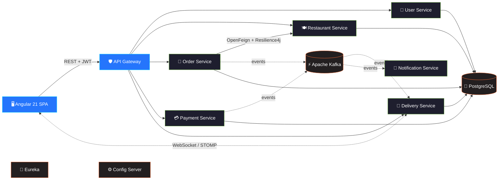

<!-- ═══════════════════════════ HEADER ═══════════════════════════ -->
<div align="center">


<a href="https://github.com/UDAY1810">
  
</a>

<br/>

<a href="mailto:mrdubey7717@gmail.com"></a>
<!-- TODO: replace YOUR-LINKEDIN-ID and YOUR-INSTAGRAM-ID below -->
<a href="https://www.linkedin.com/in/YOUR-LINKEDIN-ID/"></a>
<a href="https://www.instagram.com/YOUR-INSTAGRAM-ID/"></a>


</div>


<!-- ═══════════════════════════ ABOUT ═══════════════════════════ -->
##  About Me

```java
public final class Developer implements Scalable, Resilient {

    String   role          = "Backend Engineer";
    String[] languages     = { "Java 21", "TypeScript", "SQL" };
    String[] backend       = { "Spring Boot", "Spring Cloud", "Spring Security", "JPA / Hibernate" };
    String[] messaging     = { "Apache Kafka", "WebSocket (STOMP)" };
    String[] data          = { "PostgreSQL", "Flyway", "H2" };
    String[] observability = { "Micrometer Tracing", "Zipkin", "Actuator" };
    String[] tooling       = { "Docker Compose", "Maven", "Git", "Postman" };
    String[] testing       = { "JUnit 5", "Mockito", "Spring Boot Test" };

    String currentFocus = "Event-driven microservices → QuickBite";
    String learning     = "Kubernetes · System Design · Distributed patterns";

    @Override
    public String motto() {
        return "Make it work, make it right, make it fast.";
    }
}
```


<!-- ═══════════════════════════ STACK ═══════════════════════════ -->
## 🛠️ Tech Stack

<div align="center">


<br/><br/>


<br/><br/>


<br/>


</div>


<!-- ═══════════════════════════ PROJECT ═══════════════════════════ -->
## 🍔 Featured Project — [QuickBite](https://github.com/UDAY1810/quickbite)

<div align="center">

**A food-ordering & delivery platform built as 9 Spring Boot microservices with an Angular 21 frontend.**

[](https://github.com/UDAY1810/quickbite)


</div>



| | Highlights |
|:-:|:--|
| 🧭 | **Service discovery & central config.** Eureka registry plus Spring Cloud Config Server |
| ⚡ | **Event-driven flow.** Order, payment, delivery and notification services talk over Kafka |
| 🛡️ | **Security at the edge.** JWT auth enforced in the reactive Spring Cloud Gateway |
| 🔁 | **Fault tolerance.** OpenFeign calls guarded by Resilience4j circuit breakers |
| 🔍 | **Observability.** Distributed tracing with Micrometer + Zipkin, plus Actuator health checks |
| 💳 | **Payments.** Razorpay integration in a dedicated payment service |
| 📡 | **Real-time.** Live delivery updates pushed over WebSocket (STOMP) |
| 🧪 | **Tested.** Unit and integration tests across controllers, DTOs and entities |


<!-- ═══════════════════════════ STATS ═══════════════════════════ -->
## 📊 GitHub Stats

<div align="center">


<br/>


</div>

<!-- ═══════════════════════════ SNAKE ═══════════════════════════ -->
<!-- Requires the snake GitHub Action in the UDAY1810/UDAY1810 repo (see .github/workflows/snake.yml) -->
<div align="center">
<picture>
  <source media="(prefers-color-scheme: dark)" srcset="https://raw.githubusercontent.com/UDAY1810/UDAY1810/output/github-snake-dark.svg" />
  <source media="(prefers-color-scheme: light)" srcset="https://raw.githubusercontent.com/UDAY1810/UDAY1810/output/github-snake.svg" />
  
</picture>
</div>

<!-- ═══════════════════════════ FOOTER ═══════════════════════════ -->
<div align="center">


</div>
