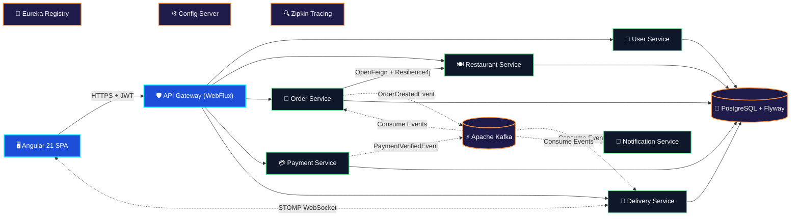
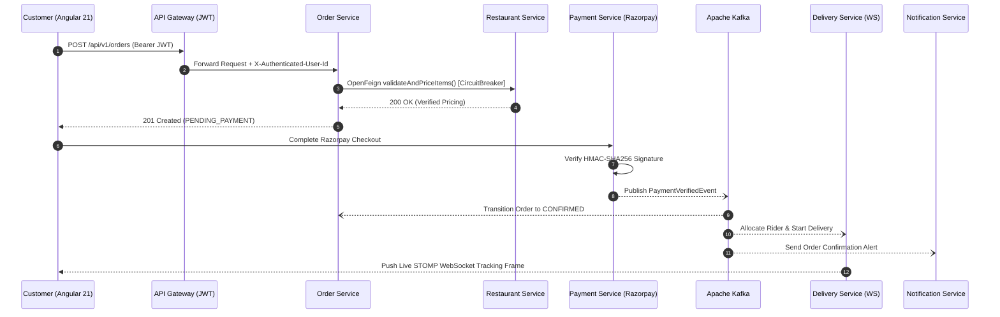
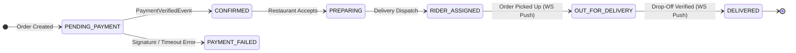

<!-- ============================================================================ -->
<!--                     UDAY — BACKEND & DISTRIBUTED SYSTEMS ENGINEER            -->
<!-- ============================================================================ -->

<div align="center">

<!-- Animated Venom Hero Banner -->


<!-- Animated Multi-Line Terminal Typing SVG -->
<a href="https://github.com/UDAY1810">

</a>

<br/>

<!-- Primary Contact & Social Badges -->
<p align="center">
<a href="mailto:mrdubey7717@gmail.com"></a>
<a href="https://github.com/UDAY1810"></a>
<a href="https://www.linkedin.com/in/YOUR-LINKEDIN-ID/"></a>
<a href="https://www.instagram.com/YOUR-INSTAGRAM-ID/"></a>

</p>

<!-- System Status Telemetry Bar -->
<p align="center">


</p>

</div>


<!-- ============================================================================ -->
<!--                  01. EXECUTIVE TELEMETRY HUD & SYSTEM SNAPSHOT               -->
<!-- ============================================================================ -->

## ⚡ Executive Engineering HUD — At-a-Glance System Profile

<table>
<tr>
<td width="25%" align="center" valign="top">
<h3>🏗️ 9 Services</h3>

<p align="center"><sub>Decomposed domain boundaries with independent PostgreSQL schemas, Eureka discovery &amp; Config Server.</sub></p>
</td>
<td width="25%" align="center" valign="top">
<h3>🔥 Event Mesh</h3>

<p align="center"><sub>Partitioned event topics driving asynchronous order sagas, payment verification &amp; live STOMP push.</sub></p>
</td>
<td width="25%" align="center" valign="top">
<h3>🛡️ Zero-Trust Edge</h3>

<p align="center"><sub>Reactive API Gateway enforcing stateless JWT verification, Resilience4j circuit breakers &amp; rate protection.</sub></p>
</td>
<td width="25%" align="center" valign="top">
<h3>🔍 Full Telemetry</h3>

<p align="center"><sub>Distributed traceId/spanId propagation across HTTP, Feign &amp; Kafka headers with Actuator health probes.</sub></p>
</td>
</tr>
</table>


<!-- ============================================================================ -->
<!--                  02. WHOAMI — JAVA 21 RECORD & ARCHITECTURAL TENETS          -->
<!-- ============================================================================ -->

##  `whoami` — Backend Engineering Identity & Runtime Spec

```java
package dev.uday.architecture.profile;

import java.util.List;
import java.util.Map;

/**
 * Production Backend Engineer specializing in resilient, event-driven
 * Java 21 & Spring Boot 3 microservice ecosystems.
 */
public final record BackendEngineerProfile(
    String handle,
    String role,
    List<String> languages,
    Map<String, List<String>> architectureStack,
    String flagshipSystem,
    String engineeringMotto
) {
    public static BackendEngineerProfile initialize() {
        return new BackendEngineerProfile(
            "UDAY1810",
            "Backend & Distributed Systems Engineer",
            List.of("Java 21 (LTS)", "TypeScript", "SQL (PostgreSQL)", "JavaScript"),
            Map.of(
                "Core & Frameworks",   List.of("Spring Boot 3.x", "Spring Cloud", "Spring Security (JWT)", "Spring Data JPA / Hibernate"),
                "Service Mesh & Edge", List.of("Spring Cloud Gateway (Reactive WebFlux)", "Netflix Eureka", "Spring Cloud Config", "OpenFeign"),
                "Event & Messaging",   List.of("Apache Kafka (Event Choreography)", "WebSocket / STOMP (Real-Time Push)"),
                "Fault Tolerance",     List.of("Resilience4j (Circuit Breaker, Retry, TimeLimiter)", "Idempotent Webhooks & Consumers"),
                "Data & Migrations",   List.of("PostgreSQL (Database-per-Service)", "Flyway Schema Versioning", "H2 In-Memory"),
                "Observability & QA",  List.of("Micrometer Tracing", "Zipkin Distributed Spans", "Spring Actuator", "JUnit 5", "Mockito")
            ),
            "QuickBite — 9-Microservice Cloud-Native Food Ordering & Delivery Platform",
            "Make it work, make it right, make it fast — and make it observable."
        );
    }
}
```

| Architectural Principle | How I Engineer It in Production Code |
| :--- | :--- |
| **🛡️ Zero-Trust Edge Security** | Stateless `Bearer` JWT verification at the reactive **Spring Cloud Gateway (WebFlux)** layer, propagating verified principal headers (`X-User-Id`, `X-User-Role`) to downstream services. |
| **⚡ Loose Coupling via Events** | State mutations in core domains (**Orders**, **Payments**) emit immutable domain events to **Apache Kafka**, allowing **Delivery** and **Notification** services to react asynchronously. |
| **🔁 Graceful Degradation** | Every synchronous inter-service **OpenFeign** call is wrapped in a **Resilience4j** `@CircuitBreaker` and `@Retry` policy so downstream latency spikes never cascade into system-wide outages. |
| **🗄️ Strict Data Ownership** | **Database-per-Service** isolation on **PostgreSQL** with automated, repeatable **Flyway** SQL migrations (`V1__init.sql`, `V2__indexes.sql`) and optimistic locking on concurrent entities. |
| **🔍 End-to-End Traceability** | Distributed `traceId` and `spanId` propagation across HTTP, Feign, and Kafka headers via **Micrometer Tracing + Zipkin**, paired with **Spring Boot Actuator** readiness/liveness probes. |


<!-- ============================================================================ -->
<!--                  03. TECH ARSENAL & ENGINEERING STACK                        -->
<!-- ============================================================================ -->

## 🛠️ Tech Arsenal & Engineering Stack

<div align="center">


</div>

<br/>

<table>
<thead>
<tr>
<th align="left" width="24%">Layer / Domain</th>
<th align="left" width="76%">Technologies, Frameworks &amp; Production Tooling</th>
</tr>
</thead>
<tbody>
<tr>
<td><b>☕ Languages &amp; Core</b></td>
<td>


</td>
</tr>
<tr>
<td><b>🌱 Spring Ecosystem</b></td>
<td>


</td>
</tr>
<tr>
<td><b>🧭 Distributed Cloud</b></td>
<td>


</td>
</tr>
<tr>
<td><b>⚡ Messaging &amp; Push</b></td>
<td>


</td>
</tr>
<tr>
<td><b>🗄️ Data, DevOps &amp; QA</b></td>
<td>


</td>
</tr>
</tbody>
</table>


<!-- ============================================================================ -->
<!--                  04. PRODUCTION CODEBASE DESIGN PATTERNS (5 DRAWERS)         -->
<!-- ============================================================================ -->

## 💻 Inside My Backend Codebase — 5 Production Design Patterns

> **Click any module below** to inspect the exact patterns I use across my microservices for **fault-tolerant RPC**, **reactive JWT edge security**, **Kafka + STOMP choreography**, **HMAC-SHA256 webhook idempotency**, and **Flyway database migrations**.

<details open>
<summary><b>🔁 1. Fault-Tolerant Synchronous RPC &amp; Event Publishing (OpenFeign + Resilience4j + Kafka)</b></summary>
<br/>

```java
package com.quickbite.order.service;

import io.github.resilience4j.circuitbreaker.annotation.CircuitBreaker;
import io.github.resilience4j.retry.annotation.Retry;
import lombok.RequiredArgsConstructor;
import lombok.extern.slf4j.Slf4j;
import org.springframework.kafka.core.KafkaTemplate;
import org.springframework.stereotype.Service;
import org.springframework.transaction.annotation.Transactional;

@Slf4j
@Service
@RequiredArgsConstructor
public class OrderOrchestrationService {

    private static final String ORDER_EVENTS_TOPIC = "quickbite.orders.lifecycle.v1";

    private final RestaurantFeignClient restaurantClient;
    private final OrderRepository orderRepository;
    private final KafkaTemplate<String, OrderCreatedEvent> kafkaTemplate;

    @Transactional
    @Retry(name = "restaurantCatalogRetry")
    @CircuitBreaker(name = "restaurantCatalogCB", fallbackMethod = "handleCatalogUnavailable")
    public OrderResponse placeOrder(String userId, CreateOrderRequest request) {
        // 1. Synchronous Feign validation guarded by Resilience4j Circuit Breaker
        MenuValidationResponse validation = restaurantClient.validateAndPriceItems(
            request.restaurantId(), request.items()
        );

        // 2. Persist order aggregate in Order Service's dedicated PostgreSQL schema
        OrderEntity savedOrder = orderRepository.save(
            OrderEntity.createPending(userId, request.restaurantId(), validation.totalAmount())
        );

        // 3. Publish immutable domain event to Apache Kafka partitioned by orderId
        OrderCreatedEvent event = OrderCreatedEvent.from(savedOrder, request.deliveryAddress());
        kafkaTemplate.send(ORDER_EVENTS_TOPIC, savedOrder.getId().toString(), event)
            .whenComplete((result, ex) -> {
                if (ex != null) {
                    log.error("Failed to publish OrderCreatedEvent for orderId={}", savedOrder.getId(), ex);
                } else {
                    log.info("Published OrderCreatedEvent [partition={}, offset={}]",
                        result.getRecordMetadata().partition(),
                        result.getRecordMetadata().offset());
                }
            });

        return OrderResponse.from(savedOrder);
    }

    // Graceful fallback when Restaurant Service is degraded or circuit is OPEN
    public OrderResponse handleCatalogUnavailable(String userId, CreateOrderRequest req, Throwable t) {
        log.warn("CircuitBreaker OPEN for restaurantId={} - reason: {}", req.restaurantId(), t.getMessage());
        throw new ServiceTemporarilyUnavailableException(
            "Restaurant catalog is momentarily busy. Please retry your order in a few seconds."
        );
    }
}
```

</details>

<details>
<summary><b>🛡️ 2. Reactive API Gateway JWT Authentication Filter (Spring Cloud Gateway + WebFlux)</b></summary>
<br/>

```java
package com.quickbite.gateway.security;

import io.jsonwebtoken.Claims;
import lombok.RequiredArgsConstructor;
import org.springframework.cloud.gateway.filter.GatewayFilterChain;
import org.springframework.cloud.gateway.filter.GlobalFilter;
import org.springframework.core.Ordered;
import org.springframework.http.HttpHeaders;
import org.springframework.http.HttpStatus;
import org.springframework.http.server.reactive.ServerHttpRequest;
import org.springframework.stereotype.Component;
import org.springframework.web.server.ServerWebExchange;
import reactor.core.publisher.Mono;

@Component
@RequiredArgsConstructor
public class ReactiveJwtAuthenticationFilter implements GlobalFilter, Ordered {

    private final JwtTokenValidator jwtValidator;
    private final RouteValidator routeValidator;

    @Override
    public Mono<Void> filter(ServerWebExchange exchange, GatewayFilterChain chain) {
        ServerHttpRequest request = exchange.getRequest();

        if (routeValidator.isSecured.test(request)) {
            String authHeader = request.getHeaders().getFirst(HttpHeaders.AUTHORIZATION);
            if (authHeader == null || !authHeader.startsWith("Bearer ")) {
                exchange.getResponse().setStatusCode(HttpStatus.UNAUTHORIZED);
                return exchange.getResponse().setComplete();
            }

            try {
                Claims claims = jwtValidator.validateAndExtractClaims(authHeader.substring(7));
                // Mutate downstream request with verified identity headers
                ServerHttpRequest mutatedRequest = request.mutate()
                    .header("X-Authenticated-User-Id", claims.getSubject())
                    .header("X-Authenticated-Roles", claims.get("roles", String.class))
                    .build();
                return chain.filter(exchange.mutate().request(mutatedRequest).build());
            } catch (Exception ex) {
                exchange.getResponse().setStatusCode(HttpStatus.FORBIDDEN);
                return exchange.getResponse().setComplete();
            }
        }
        return chain.filter(exchange);
    }

    @Override
    public int getOrder() {
        return -1; // Execute before route forwarding filters
    }
}
```

</details>

<details>
<summary><b>⚡ 3. Event Consumer + Real-Time WebSocket Dispatch (KafkaListener + STOMP Broker)</b></summary>
<br/>

```java
package com.quickbite.delivery.messaging;

import lombok.RequiredArgsConstructor;
import lombok.extern.slf4j.Slf4j;
import org.springframework.kafka.annotation.KafkaListener;
import org.springframework.messaging.simp.SimpMessagingTemplate;
import org.springframework.stereotype.Component;
import org.springframework.transaction.annotation.Transactional;

@Slf4j
@Component
@RequiredArgsConstructor
public class PaymentVerifiedKafkaConsumer {

    private final DeliveryDispatchService dispatchService;
    private final SimpMessagingTemplate stompBroker;

    @Transactional
    @KafkaListener(
        topics = "quickbite.payments.verified.v1",
        groupId = "delivery-dispatch-group"
    )
    public void onPaymentVerified(PaymentVerifiedEvent event) {
        log.info("Received PaymentVerifiedEvent for orderId={} [txId={}]",
            event.orderId(), event.razorpayPaymentId());

        // 1. Allocate nearest available rider & persist delivery assignment
        DeliveryAssignment assignment = dispatchService.assignRider(event.orderId(), event.dropLocation());

        // 2. Push real-time status frame to Angular 21 client over STOMP WebSocket
        LiveTrackingPayload payload = LiveTrackingPayload.of(
            event.orderId(),
            DeliveryStatus.RIDER_ASSIGNED,
            assignment.getRiderName(),
            assignment.getEstimatedArrivalMinutes()
        );
        stompBroker.convertAndSend("/topic/orders/" + event.orderId() + "/tracking", payload);
    }
}
```

</details>

<details>
<summary><b>💳 4. Idempotent Razorpay Webhook &amp; HMAC-SHA256 Signature Verification (Payment Service)</b></summary>
<br/>

```java
package com.quickbite.payment.security;

import javax.crypto.Mac;
import javax.crypto.spec.SecretKeySpec;
import java.nio.charset.StandardCharsets;
import java.security.MessageDigest;
import java.util.HexFormat;
import lombok.RequiredArgsConstructor;
import lombok.extern.slf4j.Slf4j;
import org.springframework.beans.factory.annotation.Value;
import org.springframework.kafka.core.KafkaTemplate;
import org.springframework.stereotype.Service;
import org.springframework.transaction.annotation.Transactional;

@Slf4j
@Service
@RequiredArgsConstructor
public class RazorpayWebhookVerifierService {

    @Value("${razorpay.webhook.secret}")
    private String webhookSecret;

    private final PaymentLedgerRepository paymentRepository;
    private final KafkaTemplate<String, PaymentVerifiedEvent> kafkaTemplate;

    @Transactional
    public void verifyAndCapturePayment(PaymentCallbackRequest callback, String signatureHeader) {
        // 1. Constant-time HMAC-SHA256 signature verification
        String payload = callback.razorpayOrderId() + "|" + callback.razorpayPaymentId();
        String computedHmac = computeHmacSha256(payload, webhookSecret);

        if (!MessageDigest.isEqual(computedHmac.getBytes(StandardCharsets.UTF_8),
                                   signatureHeader.getBytes(StandardCharsets.UTF_8))) {
            throw new SecurityException("Invalid Razorpay HMAC-SHA256 signature");
        }

        // 2. Idempotency guard: skip duplicate webhook deliveries safely
        if (paymentRepository.existsByRazorpayPaymentId(callback.razorpayPaymentId())) {
            log.info("Duplicate webhook ignored for paymentId={}", callback.razorpayPaymentId());
            return;
        }

        // 3. Mark ledger CAPTURED & emit PaymentVerifiedEvent to Kafka
        PaymentEntity ledger = paymentRepository.markCaptured(callback.orderId(), callback.razorpayPaymentId());
        kafkaTemplate.send("quickbite.payments.verified.v1",
            ledger.getOrderId().toString(),
            PaymentVerifiedEvent.from(ledger)
        );
    }

    private String computeHmacSha256(String data, String secret) {
        try {
            Mac mac = Mac.getInstance("HmacSHA256");
            mac.init(new SecretKeySpec(secret.getBytes(StandardCharsets.UTF_8), "HmacSHA256"));
            return HexFormat.of().formatHex(mac.doFinal(data.getBytes(StandardCharsets.UTF_8)));
        } catch (Exception ex) {
            throw new IllegalStateException("Failed to compute HMAC-SHA256", ex);
        }
    }
}
```

</details>

<details>
<summary><b>🗄️ 5. Versioned Database-per-Service Schema Migration (Flyway + PostgreSQL Optimistic Locking)</b></summary>
<br/>

```sql
-- Flyway Migration: V1__init_orders_schema.sql (Order Service Dedicated Schema)
CREATE TABLE IF NOT EXISTS orders (
    id                  UUID PRIMARY KEY,
    user_id             VARCHAR(64)    NOT NULL,
    restaurant_id       UUID           NOT NULL,
    order_status        VARCHAR(32)    NOT NULL DEFAULT 'PENDING_PAYMENT',
    total_amount        NUMERIC(10, 2) NOT NULL CHECK (total_amount >= 0),
    delivery_address    TEXT           NOT NULL,
    version             BIGINT         NOT NULL DEFAULT 0, -- JPA @Version optimistic lock
    created_at          TIMESTAMPTZ    NOT NULL DEFAULT NOW(),
    updated_at          TIMESTAMPTZ    NOT NULL DEFAULT NOW()
);

CREATE INDEX idx_orders_user_created ON orders (user_id, created_at DESC);
CREATE INDEX idx_orders_status       ON orders (order_status);
```

</details>


<!-- ============================================================================ -->
<!--                  05. FLAGSHIP DISTRIBUTED SYSTEM — QUICKBITE                 -->
<!-- ============================================================================ -->

## 🍔 Flagship Distributed System — [QuickBite](https://github.com/UDAY1810/quickbite)

<div align="center">

### **Cloud-Native Food Ordering & Real-Time Delivery Platform**
*A production-styled 9-microservice Spring Boot 3 & Java 21 platform with an Angular 21 SPA, Apache Kafka event backbone, Razorpay payments, STOMP WebSockets, and Zipkin distributed tracing.*

<p align="center">
<a href="https://github.com/UDAY1810/quickbite"></a>


</p>

</div>

### 🗺️ System Architecture Topology



### 🔄 End-to-End Distributed Order Saga Sequence



### 📡 Real-Time Order State Machine (Delivery & Order Lifecycle)



### 🗂️ Complete 9-Microservice Breakdown

| # | Microservice | Primary Responsibility | Key Stack & Patterns | Persistence / Broker |
| :-: | :--- | :--- | :--- | :--- |
| `01` | **🧭 Eureka Server** | Dynamic service registry & health heartbeats | Spring Cloud Netflix Eureka | In-Memory Registry |
| `02` | **⚙️ Config Server** | Centralized external configuration management | Spring Cloud Config | Git / Native Profiles |
| `03` | **🛡️ API Gateway** | Single edge entry point, routing & JWT security filter | Spring Cloud Gateway (WebFlux), JJWT | Stateless Reactive |
| `04` | **👤 User Service** | Registration, RBAC roles, login & JWT generation | Spring Security, BCrypt, JPA | PostgreSQL + Flyway |
| `05` | **🍽️ Restaurant Service** | Restaurant onboarding, menu catalogs & item pricing | Spring Boot REST, Bean Validation | PostgreSQL + Flyway |
| `06` | **🧾 Order Service** | Order lifecycle orchestration & sync catalog checks | OpenFeign, Resilience4j, Kafka Producer | PostgreSQL + Flyway |
| `07` | **💳 Payment Service** | Checkout creation, webhook verification & ledger | Razorpay SDK, HMAC-SHA256, Kafka Producer | PostgreSQL + Flyway |
| `08` | **🛵 Delivery Service** | Rider assignment, status state machine & live tracking | Kafka Consumer, WebSocket (STOMP) | PostgreSQL + Flyway |
| `09` | **📧 Notification Service** | Asynchronous customer & restaurant event alerts | Kafka Consumer, Spring Mail / Templates | Stateless Event Consumer |


<!-- ============================================================================ -->
<!--                  06. ENGINEERING BENCHMARKS, TESTING & ROADMAP               -->
<!-- ============================================================================ -->

## 🔬 Production Readiness, Testing Pyramid & Engineering Roadmap

<table>
<tr>
<td width="50%" valign="top">

### 🧪 Quality & Reliability Guarantees

- **⚡ Non-Blocking Edge Gateway:** Reactive Netty pipeline on **Spring Cloud Gateway** keeps JWT verification and route resolution overhead minimal.
- **🔁 Circuit Breaker Isolation:** **Resilience4j** sliding-window circuit breakers trip automatically on downstream degradation, returning deterministic fallback responses instead of hanging threads.
- **🔒 Idempotent Event & Webhook Handling:** Unique constraint guards + HMAC-SHA256 verification ensure duplicate **Razorpay** webhooks or replayed **Kafka** records never double-charge or double-dispatch.
- **🧬 Automated Schema Governance:** Zero manual DDL — every microservice validates and applies versioned **Flyway** migrations on startup.
- **🧪 Multi-Layer Testing:** Controller slice tests (`@WebMvcTest`), service unit tests (**JUnit 5 + Mockito**), and repository integration tests.

</td>
<td width="50%" valign="top">

### 🚀 Current Engineering Focus & Roadmap

- [x] **9-Service Spring Boot 3 Mesh:** Eureka, Config Server, Reactive Gateway & 6 domain services
- [x] **Event-Driven Order & Payment Sagas:** Partitioned **Apache Kafka** topics + async consumers
- [x] **Real-Time Delivery Telemetry:** Live rider status broadcast over **STOMP WebSockets**
- [x] **Distributed Observability:** End-to-end **Micrometer + Zipkin** trace correlation
- [ ] **Transactional Outbox + Debezium CDC:** Guaranteeing atomic DB write + Kafka publish
- [ ] **Redis Distributed Caching & Rate Limiting:** Sub-millisecond menu catalog lookups & token bucket throttling at the Gateway
- [ ] **Kubernetes (Helm + K8s Probes):** Manifests for Horizontal Pod Autoscaling (HPA)

</td>
</tr>
</table>


<!-- ============================================================================ -->
<!--                  07. GITHUB TELEMETRY, TROPHIES & CONTRIBUTION PULSE         -->
<!-- ============================================================================ -->

## 📊 GitHub Telemetry & Contribution Pulse

<div align="center">

<!-- GitHub Trophies Row -->


<br/><br/>

<!-- Streak Stats -->


<br/><br/>

<!-- GitHub Stats & Top Languages -->


<br/><br/>

<!-- Summary Cards: Profile Details & Commit Breakdown -->


<br/><br/>

<!-- Full-Width Contribution Activity Graph -->


</div>

<!-- Requires the snake GitHub Action in UDAY1810/UDAY1810 (.github/workflows/snake.yml) -->
<div align="center">
<picture>
  <source media="(prefers-color-scheme: dark)" srcset="https://raw.githubusercontent.com/UDAY1810/UDAY1810/output/github-snake-dark.svg" />
  <source media="(prefers-color-scheme: light)" srcset="https://raw.githubusercontent.com/UDAY1810/UDAY1810/output/github-snake.svg" />
  
</picture>
</div>


<!-- ============================================================================ -->
<!--                  08. CONNECT & FOOTER                                        -->
<!-- ============================================================================ -->

<div align="center">

### 🤝 Let's Architect High-Scale Backend Systems Together

*Open to **Backend Engineer / Software Development Engineer (Java · Spring Boot · Microservices · Kafka)** opportunities and technical collaborations.*

<p align="center">
<a href="mailto:mrdubey7717@gmail.com"></a>
<a href="https://github.com/UDAY1810/quickbite"></a>
</p>

<br/>


</div>
